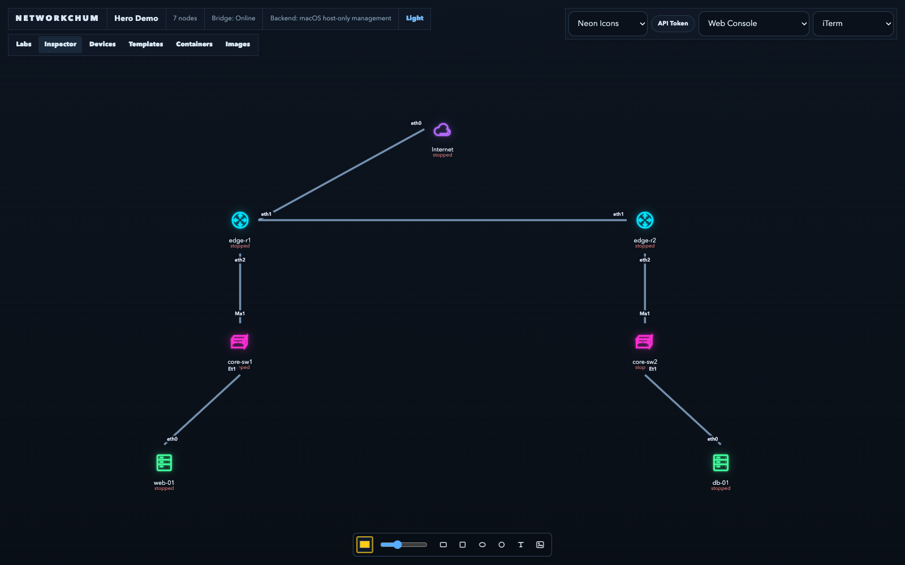
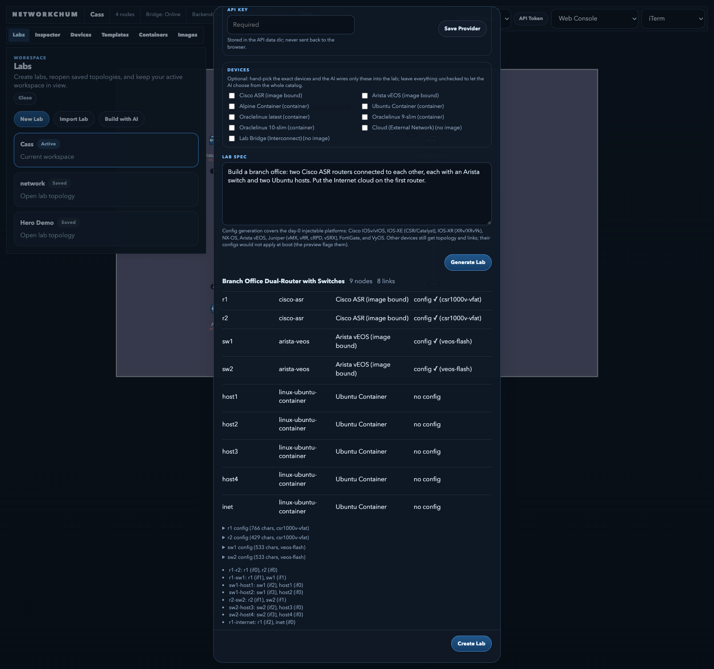
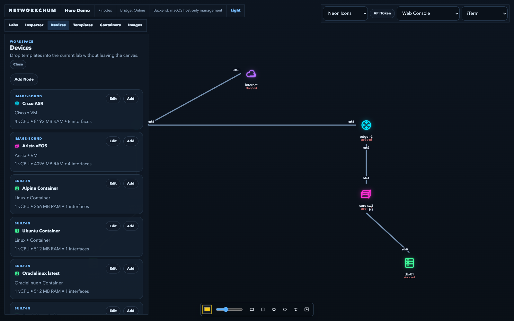
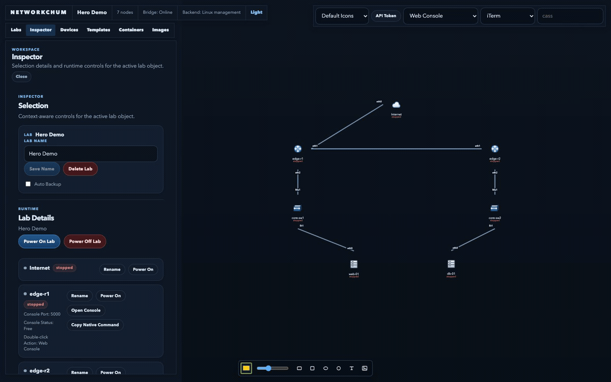

# NetworkChum



NetworkChum is a browser-based network lab workbench for building and operating small topologies with QEMU-backed virtual devices and container nodes.

The project is aimed at an EVE-NG / PNETLab style workflow, but with a JSON-native lab model, a simple local API, and a cleaner split between topology state, image management, and runtime orchestration.

## Screenshots and demo



The AI builder turns a prompt into a validated lab: routers, switches, hosts and
links, with day-0 configs for the platforms that support them.



Device catalog with image bindings and per-template resource limits.

[](docs/screenshots/demo.mp4)

A short demo (generation sped up) — click the GIF for the MP4.

There is also a standalone landing page: [`docs/index.html`](docs/index.html).
(GitHub Pages is not available for this private repo on the current plan, so the
page is served locally or by any static host.)

## What It Does Today

- Create, open, and delete labs from the web UI
- Add nodes from a device catalog
- Drag nodes around a topology canvas
- Create and remove Ethernet links between interfaces
- Power nodes on and off
- Open serial console sessions for running QEMU nodes
- Upload VM images, bind them to built-in templates, unbind them, or remove them from the active catalog
- Browse local container images, search registries, pull images, and turn them into reusable templates or one-off lab nodes
- Persist labs, runtime state, and image metadata in local JSON files
- Build a lab from a plain-English prompt with an LLM (ChatGPT, OpenCode Go,
  OpenAI, Anthropic, OpenRouter, Groq, DeepSeek, xAI, Moonshot, Mistral,
  Together, Ollama, LM Studio, or any OpenAI-compatible endpoint), including
  day-0 startup configs for supported platforms
- Link labs together with a Lab Bridge node
- Gate the API with a token and serve the UI to the LAN
- Toggle between day and night themes in the web UI

## Repo Layout

- `apps/api`
  - Fastify API for labs, catalog, images, runtime, and console transport
- `apps/web`
  - React + Vite operator UI
- `packages/shared`
  - Shared Zod schemas and TypeScript types for topology and catalog data
- `docs`
  - Design and implementation notes from the current buildout

## Architecture At A Glance

NetworkChum stores each lab as a JSON document with:

- `nodes`
- `networks`
- `attachments`

The backend treats runtime as a separate concern from topology:

- topology changes update the lab document
- power actions create or stop runtime state
- image records are stored separately from lab documents

That separation keeps the UI simple and makes it easier to evolve runtime orchestration without rewriting the topology model.

## Built-In Templates

The current template library includes:

- Linux Generic VM
- Cisco ASR
- Cisco NX-OSv
- Juniper vSRX
- Arista vEOS
- Alpine Container
- Ubuntu Container
- Nettools Container

VM templates become directly usable once a `qcow2` image is bound to them. Container templates are usable immediately.

## Requirements

For development:

- Node.js with `npm`
- a recent enough environment to run Vite, Fastify, TypeScript, and Vitest

For runtime features:

- `qemu-system-x86_64` for VM nodes
- Podman or Docker for container nodes
- Linux `ip` tooling for TAP/bridge networking on Linux hosts

Platform notes:

- Linux is the preferred runtime host. If `/dev/kvm` is available, the backend will use KVM acceleration.
- macOS is usable for API and UI development. If QEMU exposes `hvf`, NetworkChum will use it; otherwise it falls back to software emulation.
- Linux management clouds use managed TAP/bridge networking.
- macOS management clouds use a host-only static subnet on `172.31.255.0/24`, with the host at `172.31.255.1`.
- Non-management clouds on macOS and other non-Linux hosts stay socket-backed and isolated from the host LAN.

## Getting Started

### Download a release

Every tagged release publishes a source bundle and checksums on the Releases
page:

```bash
VERSION=1.0.0
curl -LO "https://github.com/Cass67/networkchum/releases/download/v${VERSION}/networkchum-${VERSION}.tar.gz"
curl -LO "https://github.com/Cass67/networkchum/releases/download/v${VERSION}/SHA256SUMS"
sha256sum -c SHA256SUMS
tar -xzf "networkchum-${VERSION}.tar.gz"
cd "networkchum-${VERSION}"
./install.sh
```

The bundle contains the source and lockfile; `install.sh` installs the runtime
dependencies and builds the app. On macOS use `brew install node` first, then
`./start.sh`.

### From a clone

Install dependencies from the repo root:

```bash
npm install
```

Start the full stack:

```bash
./start.sh
```

That starts:

- the API on `http://127.0.0.1:4000`
- the web UI on `http://127.0.0.1:5173`
- the native console bridge on `http://127.0.0.1:4010`

The web UI calls the API directly on port `4000`; there is no `/api` proxy.

Before starting, check what the app will actually load:

```bash
./start.sh doctor
```

`doctor` prints the resolved data dir and images dir, how many images are found and bound to templates, the host tools (QEMU, `/dev/kvm`, Podman/Docker), and port status. If the device catalog is missing VM devices, run `doctor` first — the usual cause is that the app is pointed at a data dir with no `images/*.qcow2`.

Point the app at your image data dir explicitly when it lives outside the repo:

```bash
./start.sh --data-dir ~/networkchum-data
```

`start.sh` remembers the mode and `--data-dir` you used last (in `.networkchum/start.conf`) and reuses them when you do not pass them again. It prints a notice when it does. Override by passing the args, or clear the saved defaults with:

```bash
./start.sh forget
```

`npm run dev` is the lower-level equivalent of `./start.sh`: it runs the same three processes but skips the `start.sh` checks and never sets a data dir, so it falls back to `apps/api/data`.

If you already have a stale local dev server running, reset both processes with:

```bash
npm run dev:reset
```

You can also run each side separately:

```bash
npm run dev:api
npm run dev:web
```

For Linux TAP labs without repeated password prompts, use:

```bash
./start.sh lan --sudo-api --data-dir ~/networkchum-data
```

## Remote Clients And Native Consoles

- **Web console** (serial and VNC) works from any browser on the LAN with no
  client install. This is the supported path for remote users.
- **Native console** opens a real terminal on the machine running the browser.
  That needs the small console bridge on that machine: download the standalone
  binary for your OS from the Releases page
  (`networkchum-console-bridge-<version>-<os>-<arch>`, a ~7 MB static binary),
  then run it. No Node.js install is needed. A Node-based tarball is published
  as a fallback.
  macOS may ask you to allow the unsigned binary (right-click → Open, or
  `xattr -d com.apple.quarantine <file>`); Windows SmartScreen: More info →
  Run anyway.
- When the app runs on another host, the bridge opens
  `ssh -t <user>@<server> 'socat ... TCP:127.0.0.1:<port>'`; you need SSH access
  to the server and `socat`/`nc` there. Windows uses its built-in OpenSSH client
  and a `cmd.exe` window.
- On a single machine, `./start.sh` starts the bridge automatically and the
  header shows `Bridge: Online`.

## Authentication

The API is token-gated. Every route except `GET /health` requires the
`x-networkchum-token` header (a `Authorization: Bearer …` header also works);
requests without it get `401`.

- **Where the token lives**: `<data-dir>/api-token` (mode `600`), generated the
  first time `./start.sh serve` runs (or via `install-service`, which starts
  `serve` under the hood). Delete the file and restart the service to rotate it.
- **First login**: the web UI pops an "API Token" dialog the moment a request is
  rejected; paste the token once and it is stored in that browser
  (`localStorage`), so you only re-enter it after a server-side rotation.
- **Retrieving the token**: `./start.sh doctor` prints it along with the data
  dir writability check. On the server: `ssh <host> 'cd ~/networkchum &&
./start.sh doctor'`.
- **Replacing it in the browser**: the floating controls bar has an
  **API Token** button next to the Icon Theme selector. It opens the same dialog
  pre-filled with the token this browser currently uses — paste a new one and
  hit _Save and Reload_.
- **Localhost dev is token-free**: the API only enforces the token when
  `NETWORKCHUM_API_TOKEN` is set, which `serve`/`install-service` always do.
  `./start.sh dev` on loopback runs without a token.

## Labs At Runtime

Labs are independent and stay running on their own:

- **Multiple labs can run at the same time.** Devices keep running while you
  browse other labs — switching labs only changes what the UI shows. Verified
  end to end: qemu VMs keep their process across lab switches, with consoles
  open.
- **Closing a console never stops a device.** The console is a websocket↔serial
  proxy; the VM keeps running and you can reconnect at any time.
- **Deploys and service restarts do not stop running VMs.** The systemd unit
  uses `KillMode=none`, so qemu VMs survive `systemctl restart` (and therefore
  the `git pull && npm run build && restart` deploy routine), and an
  `ExecStop` hook stops only the API/web processes. The runtime-state store
  tracks each VM, and consoles and network links re-attach on demand.
  `uninstall-service` tears running VMs down for real.
- Containers run via rootless `podman` as detached daemons and were never
  affected by restarts.

## Lab Bridges (Interconnect)

Two labs can share one broadcast domain: put a **Lab Bridge** node in each lab,
cable it to the network that should reach across, and point each bridge at the
other lab. Frames are merged at the virtual switch — a VM in `lab1-NY` talks to
a VM in `lab2-LA` as if both were on the same switch.

Setup (both sides are required):

1. In lab `NY`: add a **Lab Bridge (Interconnect)** device, pick `LA` as the
   peer lab, and cable the bridge into the NY network that should reach LA.
2. In lab `LA`: add a Lab Bridge, pick `NY` as the peer lab, cable it into the
   LA network.

Notes and limits:

- Bridges are virtual patch panels — no power lifecycle, no console, nothing to
  boot; the canvas shows them as `bridged`.
- Management (cloud uplink) networks are never merged — only plain lab
  networks interconnect.
- VM NICs interconnect over the socket virtual switch. Container nodes stay on
  their per-lab podman bridges and do not participate yet.
- Interconnects apply instantly on topology changes (no VM restart), and they
  survive lab switching and deploys like every other running device.

## Management Clouds

Management clouds now depend on host platform and cloud role, not on a per-node host-bridge picker.

- Linux management clouds use managed TAP/bridge networking. The default `management` bridge group maps to a managed bridge such as `nc-mgmt`.
- macOS management clouds use a fixed host-only subnet: `172.31.255.0/24`.
- On macOS, the host always uses `172.31.255.1` on that subnet.
- On macOS, assign static management IPs inside `172.31.255.0/24` to the nodes you want to reach from the host.
- On macOS, management clouds do not expose nodes directly onto the wider LAN.
- Non-management clouds stay isolated and use the existing private cloud behavior for their bridge group.

Linux operator notes:

- create a cloud node with `Cloud Role = Management`
- use bridge group `management` unless you intentionally want a separate management segment
- run `./start.sh lan --sudo-api ...` when the API needs permission to create TAP devices and managed bridges
- LAN bridging is **off by default**. NetworkChum will not move your host's network
  into `nc-mgmt` unless you opt in with `NETWORKCHUM_MANAGEMENT_UPLINK`:
  - `NETWORKCHUM_MANAGEMENT_UPLINK=<interface>` — bridge that interface (use a
    **dedicated NIC**; the host keeps its own management NIC)
  - `NETWORKCHUM_MANAGEMENT_UPLINK=auto` — let NetworkChum pick. It chooses the
    interface carrying the default route, which is usually the one you are
    connected through. A failure mid-setup leaves the host unreachable, so only
    use this when the default route is not your management path.
  - `NETWORKCHUM_MANAGEMENT_UPLINK=none` (default) — no host uplink; management
    clouds stay isolated
- if you prefer to own the bridge setup, create `nc-mgmt` and its uplink on the
  host OS (NetworkManager, netplan, etc.) and leave the env var at `none`

If you want that API elevation to run without an interactive sudo prompt, add a constrained `sudoers` rule for the exact API command on that host:

1. Generate the exact command:

```bash
./start.sh --dry-run lan --sudo-api --data-dir ~/networkchum-data
```

2. Copy only the `sudo -n env PATH=... npm run dev:api` portion.
3. Open `visudo` and add a `NOPASSWD` rule for that exact command.

Example only, adjust paths and data directory to match your dry-run output:

```sudoers
cass ALL=(root) NOPASSWD:SETENV: /usr/bin/env PATH=/usr/local/bin:/usr/sbin:/usr/bin:/sbin:/bin NETWORKCHUM_BIND_MODE=lan NETWORKCHUM_DATA_DIR=/home/cass/networkchum-data /usr/local/bin/npm run dev:api
```

Keep that rule as narrow as possible:

- use the exact `PATH` from the dry-run output
- use the exact `NETWORKCHUM_DATA_DIR` you want this host to manage
- allow only `run dev:api`, not a broader `npm` or shell rule
- edit with `visudo`, not a plain text editor

Once that rule is in place, `./start.sh lan --sudo-api --data-dir ~/networkchum-data` can start the API without stopping for a sudo password prompt.

## Data Storage

By default, the API stores local state under:

`apps/api/data`

That directory currently contains:

- `labs.json`
- `images.json`
- `runtime-states.json`
- `images/`
- `overlays/`

You can override the storage root with:

```bash
NETWORKCHUM_DATA_DIR=/path/to/data npm run dev:api
```

Important image behavior:

- images discovered by scan live under the configured images directory
- images uploaded through the UI are written under `images/uploads/`
- removing an image from the catalog does not delete the file from disk; it only marks the image as removed from active catalog use

## Image Workflow

There are two ways images enter the system:

1. Startup scan
   - when the API starts, it scans the data images directory if one exists
2. Browser upload
   - upload an image from the web UI
   - bind it to a VM template
   - it becomes usable in the device catalog

Catalog behavior today:

- bound VM images appear as `image-bound` catalog entries
- unbound VM templates still appear so you can target them during image upload/binding
- removed images stay visible in the image library, but not in the add-node catalog

## Importing Existing Labs

NetworkChum can import topology files from:

- EVE-NG and PNETLab `.unl`
- GNS3 `.gns3`
- GNS3 `.gns3project`, `.gns3p`, or `.zip` packages containing one topology file

The importer reads topology, node positions, links, interface names, and best-effort startup configs. It does not import VM disk images from packages in the first version. When an imported node references a device type or image that is not available in the local catalog, NetworkChum asks you to choose a local substitute template and, where applicable, a bound image before creating the lab.

## Container Workflow

Use the `Containers` tab when you want to work with OCI images instead of QCOW2 disks.

- NetworkChum auto-detects the local container runtime and prefers `podman` when both `podman` and `docker` are installed
- local runtime images appear in the `Containers` tab immediately
- registry search defaults to Docker Hub, but the UI also accepts direct refs such as `oraclelinux:9-slim`
- after selecting or pulling an image, you can either save it as a reusable template or create a one-off node in the active lab
- saved reusable container templates also appear in `Devices`

### Container stores are per-user

Container engines keep a separate store per user. NetworkChum runs containers as
whatever user runs the API, so:

- run the API as your normal user → containers appear in your `podman ps`
- run it with `--sudo-api` (or as a root systemd service) → containers live in
  **root's** store and only show up via `sudo podman ps`

A clean power-off removes the container, but a reboot, a killed API, or a data
reset can leave orphaned containers behind. `./start.sh doctor` shows which
engine and store are in use. Remove exited NetworkChum containers with:

```bash
./start.sh clean              # the invoking user's store
./start.sh --sudo-api clean   # root's store
```

## Useful Scripts

From the repo root:

```bash
./start.sh
./start.sh doctor
./start.sh clean
./start.sh logs
./start.sh serve
npm run dev
npm run dev:api
npm run dev:web
npm run build
npm run test
```

Per workspace:

```bash
npm run build --workspace @networkchum/api
npm run build --workspace @networkchum/web
npm run test --workspace @networkchum/api
npm run test --workspace @networkchum/web
```

## Install on a Linux host (one command)

```bash
npm install
./start.sh lan install-service --data-dir ~/networkchum-data
```

`install-service` handles the rest:

- installs dependencies and builds the production assets if they are missing
- stops an existing NetworkChum service on re-run, stopping its own orphaned
  API/web processes if the ports are still held (running VMs survive this and
  every later restart — see _Labs At Runtime_), and refuses if ports 4000/5173
  are held by something else
- pre-creates the data directory and hands it to the service user, so first
  boot never fails on stale root-owned files
- picks the service scope: on SELinux hosts where the checkout lives under your
  home directory it installs a **per-user** service with lingering (SELinux won't
  let a system unit exec a `user_home_t` script); otherwise a system service
- grants TAP/bridge capability automatically: ambient `CAP_NET_ADMIN` on a system
  service (falling back to a file capability on `ip`), or a narrowly scoped
  passwordless `sudo` rule for `ip` on SELinux hosts that don't apply file
  capabilities to the user domain — and verifies before granting, so
  non-interactive reinstalls keep the installed unit's networking mode instead
  of degrading it
- enables it at boot, starts it, and confirms it stayed active (including a live
  TAP creation check)

The service runs as **your user, not root**, so containers are rootless and show
up in your own `podman ps` — no separate root store, and the connect command works.

- Preview with `--dry-run` (prints the unit and commands, changes nothing).
- Run as another user with `--service-user NAME`.
- Logs: `./start.sh logs` (the service writes `.networkchum/service.log`), or
  `journalctl -u networkchum.service -f` (system) /
  `journalctl --user -u networkchum.service -f` (user).
- Remove it with `./start.sh uninstall-service`.

To run the production build in the foreground instead of as a service:

```bash
npm run build
./start.sh serve --data-dir ~/networkchum-data
```

`serve` runs the API on `:4000` and the built UI on `:5173`, with no watchers. It
does not run the native console bridge (a per-user, localhost-only sidecar).

## API Surface

All endpoints except `GET /health` require the `x-networkchum-token` header —
see [Authentication](#authentication) and [SECURITY.md](SECURITY.md).

Key endpoints:

- `GET /health`
- `GET /templates`
- `PATCH /templates/:templateId`
- `GET /catalog`
- `GET /containers/runtime`
- `GET /containers/images`
- `GET /containers/search`
- `POST /containers/pull`
- `POST /containers/templates`
- `GET /labs`
- `POST /labs`
- `GET /labs/:labId`
- `DELETE /labs/:labId`
- `POST /labs/:labId/nodes`
- `POST /labs/:labId/container-nodes`
- `DELETE /labs/:labId/nodes/:nodeId`
- `POST /labs/:labId/networks`
- `DELETE /labs/:labId/networks/:networkId`
- `POST /labs/:labId/attachments`
- `DELETE /labs/:labId/attachments/:interfaceId`
- `PATCH /labs/:labId/nodes/:nodeId/position`
- `POST /labs/:labId/nodes/:nodeId/power-on`
- `POST /labs/:labId/nodes/:nodeId/power-off`
- `GET /labs/:labId/runtime`
- `GET /images`
- `POST /images/upload`
- `POST /images/:imageId/bind-template`
- `DELETE /images/:imageId/template-binding`
- `DELETE /images/:imageId`

Console access is exposed over WebSocket at:

- `GET /labs/:labId/nodes/:nodeId/console`

## Development Notes

- the web app uses React 19 and Vite
- the API uses Fastify with multipart uploads and WebSocket support
- shared schemas live in `packages/shared`
- the current persistence model is intentionally simple and file-backed

This project is still early-stage software. The current implementation is best suited for local development, prototyping, and operator workflow iteration rather than a hardened multi-user deployment.

## Verification

Typical verification commands:

```bash
npm run test
npm run build
```

For the web workspace specifically:

```bash
npm run test --workspace @networkchum/web
npm run build --workspace @networkchum/web
```

## Current Rough Edges

- single-host only; the API is token-gated but there is no multi-user model (one token for everyone)
- file-backed persistence instead of a database
- runtime behavior is much more Linux-friendly than macOS-friendly
- VM usability depends on supplying compatible `qcow2` images and having the required host binaries installed

## License

MIT — see [LICENSE](LICENSE).
