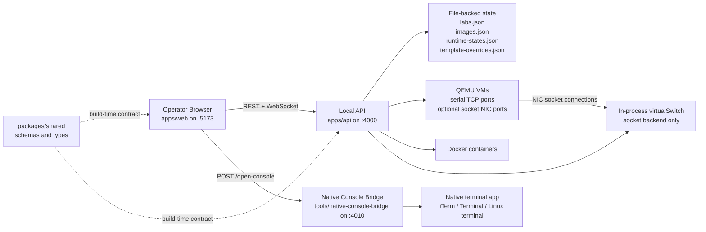
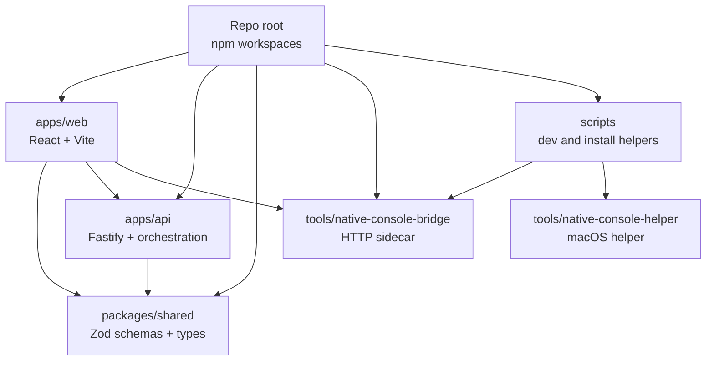
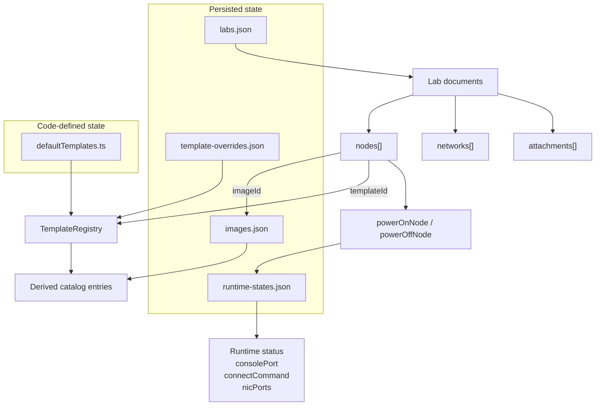
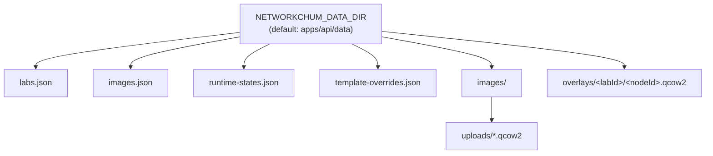
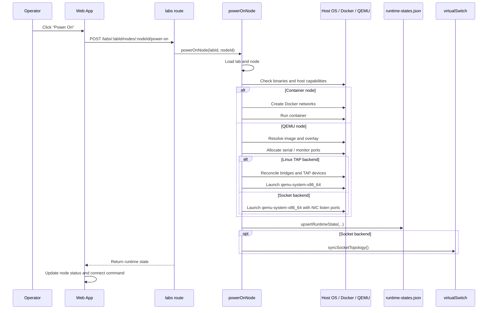
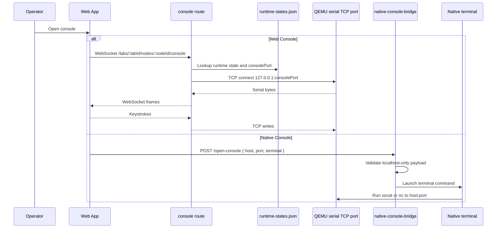
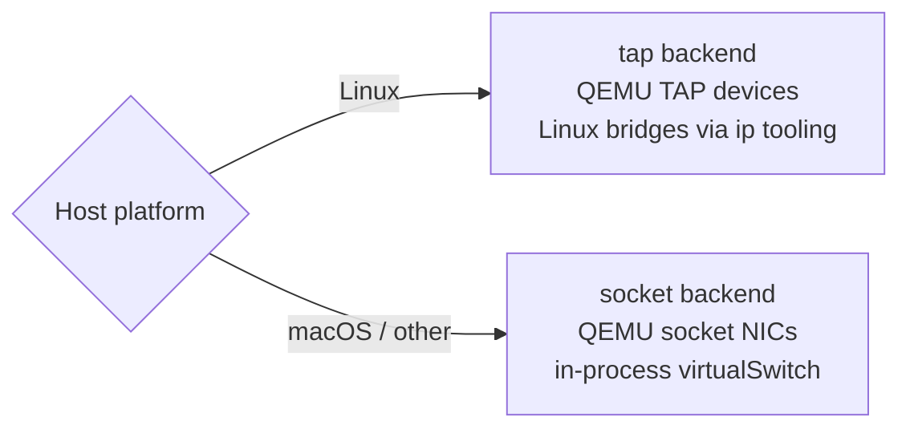

# NetworkChum Architecture

This document explains how NetworkChum works today for new contributors. It is intentionally grounded in the current implementation rather than an idealized future design.

NetworkChum is a local-first, single-host network lab workbench. The browser UI edits lab topology, the local API persists and orchestrates runtime state, and host-local tooling launches consoles and virtual network backends. The main architectural idea is that **topology state, runtime state, and catalog/image state are related but intentionally stored separately**.

## System Overview

### Core Ideas

- The browser UI is an operator console, not the system of record.
- The Fastify API is the local control plane: it owns persistence, runtime orchestration, and console transport.
- Lab topology is stored as JSON documents and can exist independently of any running node runtime.
- Runtime state is stored separately from lab topology so processes can be started, recovered, and stopped without rewriting the topology model.
- Templates and image metadata produce a derived device catalog; the catalog is not persisted as its own store.
- Native console launch is handled by sidecar tooling rather than by the API itself.

### System Context



### Main Processes and Ports

| Process                       | Default port | Purpose                                                 |
| ----------------------------- | ------------ | ------------------------------------------------------- |
| `apps/web` Vite dev server    | `5173`       | React operator UI                                       |
| `apps/api` Fastify server     | `4000`       | REST API and console WebSocket                          |
| `tools/native-console-bridge` | `4010`       | Native terminal launcher sidecar                        |
| QEMU serial/monitor ports     | `5000+`      | Per-node serial console and QEMU monitor                |
| QEMU socket NIC ports         | `20000+`     | Non-Linux NIC sockets for the in-process virtual switch |

At the repo root, `npm run dev` starts the API, web UI, and native console bridge together.

## Monorepo Structure

| Path                          | Responsibility                                                                          | Start here                                                                                                |
| ----------------------------- | --------------------------------------------------------------------------------------- | --------------------------------------------------------------------------------------------------------- |
| `apps/web`                    | React operator UI, client-side orchestration, web console UI                            | `src/App.tsx`, `src/api/client.ts`, `src/components/TopologyCanvas.tsx`, `src/components/NodeConsole.tsx` |
| `apps/api`                    | Fastify control plane, file-backed persistence, runtime orchestration, console proxying | `src/server.ts`, `src/app.ts`, `src/routes/labs.ts`, `src/runtime/powerNode.ts`                           |
| `packages/shared`             | Shared Zod schemas and TypeScript types for topology and catalog models                 | `src/topology.ts`, `src/catalog.ts`                                                                       |
| `tools/native-console-bridge` | Local HTTP sidecar that launches host-native terminal sessions                          | `server.js`                                                                                               |
| `tools/native-console-helper` | macOS helper assets for URL-scheme based terminal launch                                | `README.md`, helper app bundle                                                                            |
| `scripts`                     | Local tooling for dev bootstrapping and helper installation                             | `run-native-console-bridge.sh`, `install-networkchum-native-console-helper.sh`                            |

### Workspace Relationships



## Architectural Seams

There are four important boundaries in the current design:

1. **Topology model**: labs, nodes, networks, and attachments live in persisted lab documents.
2. **Runtime model**: running/stopped state, console ports, NIC ports, and command previews live in a separate runtime store.
3. **Catalog model**: built-in templates plus image metadata produce the visible add-node catalog.
4. **Console model**: web console transport runs through the API, but native console launch goes through a sidecar process on `127.0.0.1:4010`.

If you keep those seams clear in your head, the codebase becomes much easier to navigate.

## State and Persistence

### Where State Lives

| State               | Source of truth           | Persistence      | Primary owner                                       | Notes                                                                                                            |
| ------------------- | ------------------------- | ---------------- | --------------------------------------------------- | ---------------------------------------------------------------------------------------------------------------- |
| Labs and topology   | `labs.json`               | File-backed JSON | `labStore.ts`                                       | Stores `LabDocument` records with nodes, networks, attachments, annotations, and startup config set placeholders |
| Runtime state       | `runtime-states.json`     | File-backed JSON | `runtimeStateStore.ts`                              | Stores actual process/container status, console ports, NIC ports, and command previews                           |
| Images              | `images.json`             | File-backed JSON | `imageStore.ts`, `imageService.ts`, `scanImages.ts` | Tracks uploaded and scanned `qcow2` images plus template bindings                                                |
| Template overrides  | `template-overrides.json` | File-backed JSON | `templateOverrideStore.ts`                          | Stores user-edited default RAM/vCPU/interface counts for built-in templates                                      |
| Built-in templates  | `defaultTemplates.ts`     | Source code      | `TemplateRegistry`                                  | Static definitions for VM and container node types                                                               |
| Derived catalog     | Computed at request time  | Not persisted    | `getCatalog.ts`                                     | Join of templates and active image bindings                                                                      |
| Browser preferences | `localStorage`            | Browser storage  | `App.tsx`                                           | Theme, native console mode, and saved custom terminal definitions                                                |

### State Relationships



### Storage Layout

By default, the API stores state under `apps/api/data`, overridable via `NETWORKCHUM_DATA_DIR`.



A few persistence details matter for contributors:

- `LabDocumentSchema` in `packages/shared/src/topology.ts` already includes `annotations` and `startupConfigSets`, even though most current UI flows focus on nodes, networks, and attachments.
- QEMU nodes use per-node overlay copies stored under `overlays/<labId>/<nodeId>.qcow2`; overlays persist across power cycles and are cleaned up when a node or lab is deleted.
- The visible device catalog is derived fresh from templates and image records, so changing image bindings affects catalog contents without a separate catalog migration step.

## Subsystem Walkthrough

### Web App

The web UI is a React 19 single-page application with most orchestration living in `apps/web/src/App.tsx`.

Key responsibilities:

- load labs, catalog entries, and image records on startup
- keep track of the selected lab, node, cable, and image
- persist UI preferences in `localStorage`
- ping the native console bridge health endpoint on mount
- refresh runtime state on window focus
- open either the embedded web console or the native console path

Important implementation notes:

- `src/api/client.ts` wraps the REST API, but it does **not** own all transport. The web console WebSocket and the native console bridge fetch both bypass the API client abstraction and are called directly from `App.tsx` and `NodeConsole.tsx`.
- `TopologyCanvas.tsx` is the main topology interaction surface. It handles dragging, panning, multi-select, cable drawing, and link visualization.
- `NodeConsole.tsx` lazy-loads xterm and opens a direct WebSocket to `ws://127.0.0.1:4000/labs/:labId/nodes/:nodeId/console`.
- There is no router and no dedicated state container library. `App.tsx` is currently the front-end composition root and de facto client-side control plane.

### API App and Route Layer

`apps/api/src/server.ts` starts the Fastify app and performs two startup tasks:

- `syncSocketTopology()` to rebuild the in-process virtual switch on socket-backed hosts
- `scanImages(getImagesDir())` to discover disk images on startup

`apps/api/src/app.ts` registers the route surface:

- `healthRoutes`
- `consoleRoutes`
- `templateRoutes`
- `imageRoutes`
- `catalogRoutes`
- `labRoutes`

The API layer is thin in some places and orchestration-heavy in others:

- Routes validate input with Zod at the boundary.
- `buildApp()` accepts injected runtime helpers for command execution and binary checks, which makes the runtime code testable.
- `routes/labs.ts` is broader than the name suggests. It owns lab CRUD, node and cable mutations, runtime status queries, power actions, and console-disconnect behavior.

### Lab Topology and Mutation Flow

Topology changes are intentionally modeled as document transforms plus store writes.

- `labStore.ts` is the file-backed lab repository.
- `mutations.ts` contains pure document transforms such as `addNode`, `addNetwork`, `attachInterfaces`, `moveNode`, and `removeNetwork`.
- `nodeService.ts` wraps node deletion with runtime cleanup.
- `cableService.ts` removes networks from the topology document.
- `labService.ts` wraps lab deletion with per-node runtime cleanup.

This is a useful architectural pattern in the repo: the topology mutation functions are mostly pure, while cleanup and orchestration happen in service or route layers.

One nuance for contributors: the node schema includes `state.desiredPower`, but actual running/stopped status is tracked in `runtime-states.json`. Those two models are not fully unified yet.

### Templates, Images, and the Derived Catalog

Template and image handling are separated deliberately:

- `defaultTemplates.ts` defines the built-in node types and their resource bounds.
- `TemplateRegistry` overlays user-adjusted defaults from `template-overrides.json`.
- `imageService.ts` handles upload, bind/unbind, catalog removal, and file deletion.
- `scanImages.ts` scans `qcow2` files, preserves prior bindings where possible, and heuristically suggests template IDs based on filenames.
- `getCatalog.ts` joins templates and images into the operator-visible catalog.

Important behavior:

- Container templates always appear in the catalog.
- VM templates appear even when no image is bound so the UI can still target them during upload/binding.
- When an image is bound to a VM template, the catalog entry becomes image-bound.
- Removing an image from the catalog does not necessarily delete the file; removing the file is a separate action.

The catalog is therefore a **view**, not a store.

### Runtime Orchestration

Runtime behavior is centered in `apps/api/src/runtime/powerNode.ts`.

#### Container path

For container nodes, `powerOnNode()`:

- determines network attachments from the lab document
- creates Docker bridge networks for those attachments
- builds a `docker run` command via `buildContainerSpec.ts`
- starts the container and records a `docker exec -it ... sh` connect command in runtime state

For power-off, it disconnects the container from attached Docker networks, stops the container, and removes it.

#### QEMU path

For QEMU nodes, `powerOnNode()`:

- checks that `qemu-system-x86_64` exists
- resolves the node image, falling back to a blank image if necessary
- clones or reuses a per-node overlay disk
- attempts process recovery by checking whether another QEMU process already holds the overlay disk
- chooses a serial port block and, on socket-backed hosts, a NIC port block
- reconciles Linux bridge/TAP devices when using the TAP backend
- attaches optional sidecar drives such as `cdrom.iso` or `hdb.qcow2`
- builds the final QEMU command in `buildQemuCommand.ts`
- launches QEMU detached and stores runtime metadata

Power-off kills the QEMU process, removes TAP devices or virtual-switch registrations, and persists a stopped runtime state.

Supporting runtime modules:

- `hostCapabilities.ts` decides acceleration mode (`kvm`, `hvf`, `tcg`, or none) and whether networking uses `tap` or `socket`.
- `runtimeStateStore.ts` persists runtime metadata separately from topology.
- `runtimeCleanupService.ts` powers nodes off, removes runtime state, and deletes overlay artifacts.
- `syncSocketTopology.ts` rebuilds the socket-backed topology view from stored runtime states plus lab attachments.
- `virtualSwitch.ts` is an in-process Ethernet frame forwarder used only for socket-backed QEMU networking.

### Console Transport and Native Console Tooling

There are two console paths.

#### Embedded web console

- `NodeConsole.tsx` opens the full-screen xterm terminal.
- It creates a WebSocket connection to the API console route.
- `routes/console.ts` looks up the node runtime state, finds the serial TCP port, and proxies bytes between browser WebSocket frames and the QEMU serial socket.

This path is only valid for running QEMU nodes with an active serial console port.

#### Native console launch

- The web app stores console preferences locally and health-checks the bridge on `127.0.0.1:4010`.
- When the user chooses native console launch, `App.tsx` POSTs an `open-console` request to `tools/native-console-bridge/server.js`.
- The bridge validates that the request targets `localhost` and then launches a host-native terminal command through `osascript` on macOS or a detected terminal launcher on Linux.
- The bridge prefers `socat` and falls back to `nc` for the actual console transport command.

The repo also contains `tools/native-console-helper`, a macOS URL-scheme helper. That helper exists alongside the bridge, but the main browser integration currently targets the bridge directly.

## Key Flows

### Topology Editing

The common edit path looks like this:

1. The UI issues a REST call through `api/client.ts`.
2. `routes/labs.ts` validates the request and loads the lab document.
3. A mutation or service updates the topology document.
4. `labStore.ts` rewrites `labs.json`.
5. If the change affects live socket-backed networking, the API calls `syncSocketTopology()`.
6. The updated lab document returns to the UI and replaces local state.

This is why topology changes are easy to reason about: they are still just document rewrites, even when runtime side effects are attached.

### Powering On a Node



### Console Access



## Platform-Specific Behavior

NetworkChum intentionally behaves differently depending on the host.



What this means in practice:

- **Linux** is the preferred runtime host for QEMU. If `/dev/kvm` is available, the API uses KVM acceleration and TAP-based networking.
- **macOS** uses HVF if available, otherwise software emulation (`tcg`). Because TAP networking is not the default path there, QEMU NICs expose socket listeners and the API process forwards frames in `virtualSwitch.ts`.
- **Containers** use Docker bridge networks and are managed separately from the QEMU networking backend choice.

This split is one of the most important runtime concepts in the repository. Many topology operations are shared, but network realization is not.

## Contributor Starting Points

| If you want to change...                  | Open these files first                                                                                                                                                        | Why                                                                       |
| ----------------------------------------- | ----------------------------------------------------------------------------------------------------------------------------------------------------------------------------- | ------------------------------------------------------------------------- |
| Lab schema or topology model              | `packages/shared/src/topology.ts`, `apps/api/src/topology/mutations.ts`, `apps/api/src/routes/labs.ts`, `apps/web/src/api/client.ts`                                          | Schema changes ripple across API validation, persistence, and UI payloads |
| Canvas interactions or selection behavior | `apps/web/src/App.tsx`, `apps/web/src/components/TopologyCanvas.tsx`, `apps/web/src/components/SelectionPanel.tsx`                                                            | The canvas and selection model are UI-driven and coordinated in `App.tsx` |
| Runtime start/stop behavior               | `apps/api/src/runtime/powerNode.ts`, `apps/api/src/runtime/runtimeStateStore.ts`, `apps/api/src/runtime/hostCapabilities.ts`, `apps/api/src/runtime/qemu/buildQemuCommand.ts` | Most runtime orchestration lives here                                     |
| Image upload/binding/catalog behavior     | `apps/api/src/images/imageService.ts`, `apps/api/src/images/scanImages.ts`, `apps/api/src/catalog/getCatalog.ts`, `apps/api/src/templates/templateRegistry.ts`                | The visible catalog is derived from these modules                         |
| Web console behavior                      | `apps/web/src/components/NodeConsole.tsx`, `apps/api/src/routes/console.ts`                                                                                                   | Browser terminal and serial proxy meet here                               |
| Native console behavior                   | `apps/web/src/App.tsx`, `tools/native-console-bridge/server.js`, `tools/native-console-helper/README.md`                                                                      | The UI, HTTP bridge, and helper assets are split across these modules     |
| Cleanup and deletion behavior             | `apps/api/src/runtime/runtimeCleanupService.ts`, `apps/api/src/topology/nodeService.ts`, `apps/api/src/labs/labService.ts`                                                    | Deletion is where topology and runtime cleanup reconnect                  |

## Known Gaps and Likely Evolution

These are not theoretical issues; they follow directly from the current implementation.

- `apps/web/src/App.tsx` is large and acts as the front-end orchestration layer. Over time, expect pressure to extract feature-level hooks or modules.
- Persistence is simple whole-file JSON rewrite storage. That is fine for local single-user workflows, but there is no locking, transaction model, or multi-user concurrency story.
- `LabDocument.state.desiredPower` exists in the schema, but actual runtime truth lives in `runtime-states.json`. Those two models can drift and likely need unification.
- Live topology synchronization is strongest on socket-backed QEMU because `virtualSwitch` can remap attachments at runtime. Linux TAP and container networking rely more heavily on launch-time reconciliation.
- The native console architecture is mid-transition: the bridge is wired into the UI, the helper app exists separately, and custom terminal definitions are stored in the browser but are not yet a fully integrated end-to-end runtime contract.
- Container templates are differentiated in the catalog and configuration layer, but the current runtime start path still launches a hard-coded container image in `powerNode.ts`.
- The web console and bridge paths assume direct localhost access (`127.0.0.1`), which is appropriate for local development but becomes a constraint if the app is ever packaged or hosted differently.
- Runtime status refresh is request-based, not streamed. The UI refreshes runtime state on explicit actions and on window focus rather than via a push channel.

## Working in This Repo

Useful commands from the repo root:

```bash
npm run dev
npm run test
npm run build
```

Workspace-specific commands:

```bash
npm run test --workspace @networkchum/api
npm run test --workspace @networkchum/web
npm run build --workspace @networkchum/api
npm run build --workspace @networkchum/web
node --test tools/native-console-bridge/server.test.js
```

When making architectural changes, verify both the model boundary and the user-visible flow. In this repo, those often diverge: a feature can look complete in the UI while still missing the runtime or storage side of the contract.
